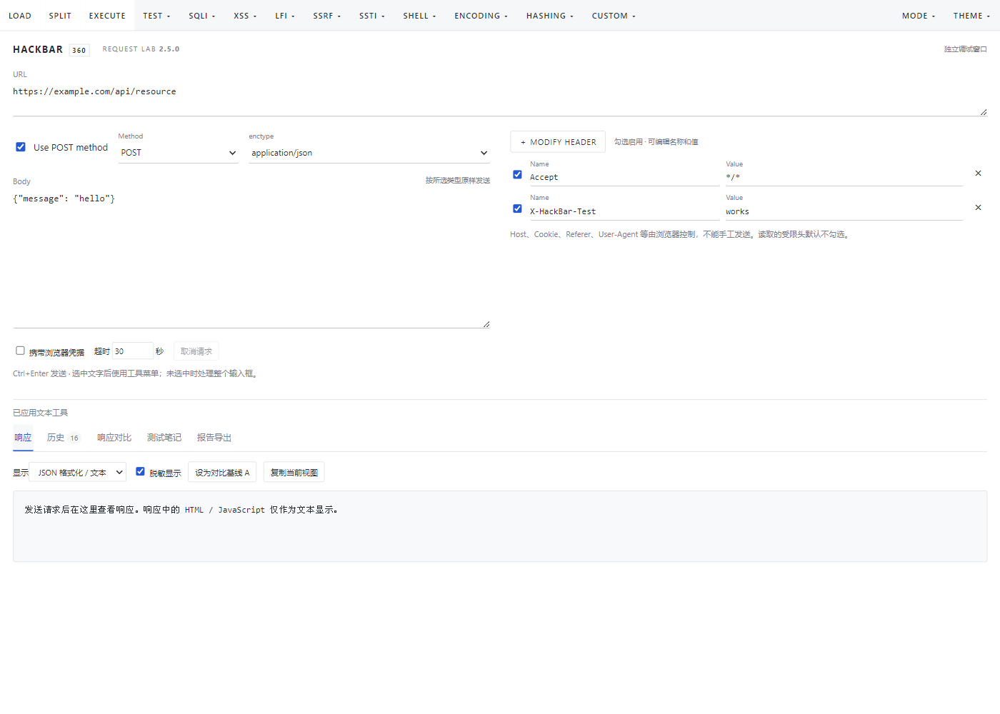
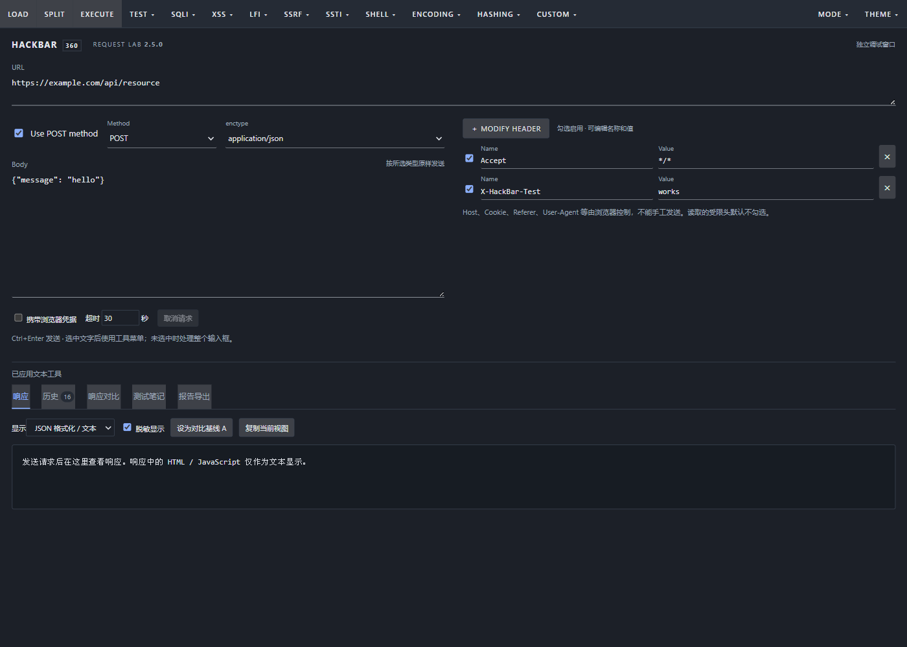

# HackBar-360 · Request Lab

面向 360 Chromium / 极速模式的 HackBar 扩展，提供手工 API 请求调试、历史记录、响应对比、测试笔记与脱敏报告。当前版本 **2.5.0**，沿用 **Manifest V2**。

## 下载与安装

前往 [v2.5.0 发布页](https://github.com/hnytgl/HackBar-360/releases/tag/v2.5.0)，下载 **HackBar-360-v2.5.0.zip** 并解压。

在 360 扩展管理页面开启开发者模式，加载解压后**直接包含 `manifest.json` 的文件夹**。本安装 ZIP 的清单位于根目录，没有额外嵌套。目标页面使用极速模式，按 **F12 → HackBar**；也可通过扩展图标打开独立调试窗口。

若下载的是 GitHub 自动生成的 Source code ZIP，解压后选择其内含 `manifest.json` 的仓库文件夹。仓库源码无需构建即可加载。

## 界面

顶部横向菜单和 URL 区，左侧 POST 开关及请求体，右侧可编辑请求头。支持浅色、深色和窄窗口布局。

深色界面

## 功能

- GET、POST、PUT、PATCH、DELETE、HEAD、OPTIONS；JSON、form、raw 正文和自定义请求头。
- 状态、耗时、正文、响应头、取消与超时处理；从 DevTools Network 读取并回填请求。
- 本地脱敏历史：搜索、回填、删除、清空；响应基线和按行对比。
- 测试笔记及 HTML / Markdown / JSON 脱敏报告导出。
- 原 HackBar 编码、哈希、SQL 字符表达式、HTML / XSS 文本转换等工具，补充 UTF-8 和严格输入校验。

## 兼容性与限制

已在 Windows 上通过 Chromium 130 的真实扩展、DevTools 和本地回显服务验证，包含语法 / 静态检查、请求方法、取消 / 超时、历史、对比和报告下载。已在 360 品牌浏览器实测；目标版本必须允许加载 Manifest V2，IE 兼容模式不受支持。

Host、Cookie、Referer、User-Agent 等浏览器控制的请求头不能任意设置；Cookie 发送取决于浏览器策略。3xx 不自动跟随。请求体上限 1 MiB，实时响应上限 2 MiB，历史另有截断。自动脱敏不能识别任意秘密，分享前须人工复核。

详细内容见 [安装与使用说明](README-360.md)、[验证记录](VALIDATION.md) 和 [来源说明](NOTICE.md)。原始上传包中的作者说明保留于对应源文件；未擅自为上游代码指定新许可证。
